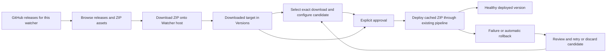

# Plan: Per-watcher GitHub release catalog

Status: core catalog implementation completed and locally verified; live GitHub and Windows acceptance remains pending.
Updated: 2026-10-22.
Checkout inspected: `/home/fanboykun/dev/work/deploy-shell`, branch `feat/release-catalog`.
Baseline: `c961e85` implements the catalog; `b745c4f` adds the general task list.

## What we are building

Each watcher should let an operator browse its GitHub repository's releases,
download a chosen release asset onto the Watcher host, prepare configuration for
that version, and explicitly deploy the downloaded artifact through Watcher's
normal deployment pipeline.

The original request on October 9 was to let users view all GitHub releases,
download them, configure them as deployment candidates, and deploy them. The
follow-up clarified that a download means a file in Watcher's downloads directory
that exists as a deployable target/version. The October 22 clarification preserves
that objective: GitHub releases should be manageable and deployable via Watcher.

Example: production runs `v3`. The operator finds an older `v2` or a prerelease,
downloads its ZIP, prepares its environment, and deploys that exact ZIP without
changing the watcher's configured polling release reference. The downloaded
target remains listed after a dashboard refresh or an agent restart.

“All releases” means releases are reachable through pagination, including older
releases and prereleases. Deployment still requires a published, compatible ZIP
asset. Drafts and releases without a deployable asset remain inspectable with a
clear explanation; they must not be silently deployed as another release.

## Product flow and vocabulary



| Term | Meaning |
| --- | --- |
| GitHub release | Remote release ID, tag, notes, publication status, and assets. |
| Downloaded target | Local immutable ZIP plus a `CatalogArtifact` record and checksum. It is deployable without another GitHub artifact download. |
| Selected candidate | The exact local artifact selected for review and deployment. Selection holds automatic activation. |
| Candidate configuration | Existing per-service revisions keyed by target version, with `next` fallback. These contain environment content and optional managed app-dir/release-dir file overrides. |
| Retained deployed version | An extracted release and its trusted configuration snapshot, eligible for the existing rollback workflow. |

A downloaded ZIP is not automatically a rollback target: it has not necessarily
been activated or given a trusted deployed configuration snapshot.

## Existing implementation versus remaining work

The next agent should complete and verify the current feature, rather than build
a second catalog beside it.

| Capability | Current evidence | Remaining work |
| --- | --- | --- |
| Repository release browsing | `ListReleaseCatalog` requests 30 releases per page and returns `has_next`; release UI includes notes and asset selection. | Browser fixtures verify pagination, older prereleases, drafts, multiple ZIPs, notes, no-ZIP, empty/error states. Live GitHub remains a release gate. |
| Host-side download | `DownloadCatalogRelease` creates a `CatalogArtifact`; `DownloadCatalogAsset` streams to a temporary file, checks ZIP structure and optional GitHub SHA-256, then renames it. | Cancellation/error cleanup, token selection, private API transport, restart persistence and download feedback verified locally. Live private repository access remains a release gate. |
| Deployable downloaded versions | `/versions` returns `downloads` separately from extracted `versions`; `DownloadedVersions` supplies configure/deploy actions. | Browser checks cover list/count refresh after download completion, navigation and reload; integration checks retain cached targets after activation, rollback, retry and discard. |
| Exact artifact selection | Candidate reservation stores `pending_catalog_id` and `pending_version`; API guards conflicting work. | Artifact-specific UI approval and exact queued attempt IDs prevent stale selections and same-artifact retry messages from acquiring another attempt. |
| Version configuration | Existing candidate endpoints/editor and exact-version → `next` → active configuration resolution, including managed files. | Fixed mounted-editor target loading; browser and API/agent tests verify target matching, isolated drafts and post-health activation. |
| Manual cached deployment | `RunCatalog` uses the existing watcher loop and `cachedArtifact`; the standard deploy pipeline is reused. | Mocked browser flow plus real API/agent cached activation, health rollback and explicit retry pass locally. Windows behavior still needs live acceptance. |
| Failure/restart recovery | Transactional attempt completion, exact attempt identity, worker join/drain, and interrupted deploy/rollback recovery. | Local regression and integration tests pass; live Windows interruption/recovery remains a release gate. |

## Phase 0: Read the contracts and inspect the checkout

Before editing, read these sources in order. Line numbers refer to this handoff
and may move; use the named symbols to relocate them.

1. `README.md:205`, “GitHub release catalog”: current user-facing behavior.
2. `docs/deployment-candidate-plan.md`: version configuration precedence,
   isolation, snapshots, and reverse-proxy paths. Parts describe historical work;
   the current source is authoritative for what exists.
3. `docs/tasks.md`: implemented navigation, update, fresh-watcher, and managed-config fixes with verification and remaining live gates.
4. `internal/database/models.go:222`: `ServiceConfigRevision` and
   `CatalogArtifact`; also inspect the watcher's pending/approved fields.
5. `internal/api/catalog_handlers.go:20`: client boundary, download, ownership,
   reservation, queueing, and local listing.
6. `internal/agent/github_catalog.go:31`: GitHub listing, resolution, download,
   artifact validation, and execution.
7. `internal/agent/config_candidates.go:13` and
   `internal/agent/watcher_deployment.go:13`: configuration and deployment reuse.
8. Watcher detail, releases, downloaded versions, and candidate Svelte components.

### Allowed APIs and patterns to reuse

| Existing API or symbol | Source / purpose |
| --- | --- |
| `GET /api/watchers/:id/releases?page=N` | `router.go`, `ListCatalogReleases`: remote releases and local downloads. |
| `POST /api/watchers/:id/releases/download` | `DownloadCatalogRelease`: accepts `release_id` and `asset_id`, resolves them server-side. |
| `POST /api/watchers/:id/releases/:cid/candidate` | `SelectCatalogCandidate`: binds the exact local artifact. |
| `POST /api/watchers/:id/releases/:cid/deploy` | `DeployCatalogRelease`: queues that local artifact. |
| `GET /api/watchers/:id/versions` | `rollback_handlers.go:15`: downloaded targets and extracted deployed versions. |
| `GET/PUT /api/watchers/:id/candidate` | `watcher_handlers.go`, `GetWatcherCandidate` / `UpdateWatcherCandidate`: existing version-specific configuration contract. |
| `POST /api/watchers/:id/approve` | `ApproveRelease`: accepts the pending `version`; catalog selection delegates to its exact artifact queue. |
| `POST /api/watchers/:id/discard` | `DiscardRelease`: releases candidate selection and removes its version-specific drafts. |
| `(*GitHubClient).ListReleaseCatalog(ctx, repoURL, page)` | `github_catalog.go:31`: existing pagination pattern. |
| `(*GitHubClient).ResolveCatalogAsset(ctx, watcher, releaseID, assetID)` | `github_catalog.go:62`: repository ownership, publication, ZIP eligibility, manifest binding. |
| `(*GitHubClient).DownloadCatalogAsset(ctx, repoURL, assetID, path, digest)` | `github_catalog.go:113`: streaming, checksum, temporary-file pattern. |
| `CatalogArtifactPath(artifact)` / `ValidateCatalogArtifact(watcher, artifact)` | `github_catalog.go:168`: derived path and local identity/checksum verification. |
| `(*RepoWatcher).RunCatalog(ctx, catalogID, deployLogID)` | `github_catalog.go:198`: exact cached artifact on the watcher loop. |
| `prepareCandidateServices(version)` / `commitCandidateServices(selected)` | `config_candidates.go:13,40`: isolated preparation and post-health persistence. |
| `CaptureConfigSnapshot`, `RestoreConfigSnapshot`, `ValidateConfigSnapshot` | `config_snapshot.go:42,125,119`: trusted configuration recovery. |

Verification: inspect `git status` and `git diff` before deciding which work is
already present. Keep the exact checkout and preserve its uncommitted changes.
Do not invent missing routes or treat this plan as a request for a new API layer.

## Phase 1: Complete release selection and candidate navigation

Copy the existing `api.getReleaseCatalog`, download, and `onNavigate` patterns
from `components/releases-tab.svelte`; use the current watcher-detail refresh
functions and candidate loader rather than adding another state owner.

- Reproduce browse → download → Configure candidate → Approve & deploy.
- Confirm the editor loads the selected pending version even if it was already
  mounted while the watcher had no pending version or a different one.
- Keep loaded target, displayed target, and approval target consistent. Ignore
  superseded responses and preserve the existing unsaved-edit safeguards.
- Refresh downloaded targets and deployment history when catalog actions finish.
- Keep compact Actions menus and all API/navigation paths under the runtime
  dashboard base path.

Original blocker (resolved): the initial mocked browser run on October 22 reached
candidate selection, but `Approve & deploy` stayed disabled. The confirmed cause
was a mounted editor loading `next` once while Releases was
active. Selecting a catalog artifact did not reload that editor. Shared mount and
navigation synchronization now reloads changed identities; stale and failed loads
invalidate approval, and unsaved edits survive routine watcher refreshes. Catalog
approval uses the existing artifact-specific deploy route with the captured ID.

Verify:

- [x] Both Releases and Versions can open the exact selected candidate.
- [x] Selection and approval work without a page reload.
- [x] Refresh and direct `?tab=candidates` entry preserve the correct target.
- [x] Loading and failures settle visibly; stale responses cannot enable approval
      for another target.
- [x] Desktop and mobile complete the flow with no browser errors.

Guard: do not remove target-matching checks merely to enable the button. Do not
rewrite the application's entire asynchronous lifecycle as part of this feature.

## Phase 2: Verify all eligible releases become durable local targets

Reuse `ResolveCatalogAsset`, `DownloadCatalogAsset`, `CatalogArtifactPath`, and
the `/versions` response. Keep the derived storage path:

```text
<install_dir>/downloads/catalog/<catalog-id>/artifact.zip
```

- Reach older pages and prereleases without falling back to `latest`.
- Bind selected release/asset IDs to this watcher's repository on the server.
- For `version.json` sources, use the configured service's declared asset and
  service version, which can differ from the release tag.
- List downloaded targets independently of remote GitHub availability; local
  Versions actions should not require browsing the remote catalog again.
- Expose enough local identity to distinguish tag, version, asset, and download.
- Give missing/changed local files an actionable recovery path. Do not claim a
  target is verified just because its database row or file exists.

Verify:

- [x] Old release, prerelease, multiple ZIPs, non-ZIP-only release, and draft cases.
- [x] Public and private repositories honor watcher-token → global-token precedence.
- [x] Failed, cancelled, invalid-ZIP, and digest-mismatch downloads leave no ready
      database record or final artifact.
- [x] Completed targets survive refresh/restart and remain distinct from rollback versions.
- [x] Deploying a previously downloaded target does not download its ZIP again.

Guard: use release/asset IDs, not a client-supplied artifact URL or filesystem
path. Do not expose tokens or hidden server paths. Keep streaming downloads;
do not buffer the artifact in memory.

## Phase 3: Finish candidate recovery and concurrency safeguards

Start by reviewing the local implementation and completion evidence below. Reuse candidate
reservation, `StateManager`, discard transactions, and existing event publishing.

- A failed/interrupted catalog attempt must close its deployment log and clear
  approval while retaining the selected download for operator review.
- Missing catalog records and version mismatches must settle queued attempts,
  just as a missing or changed ZIP does.
- After failure or successful automatic rollback, expose review, retry, and
  discard. Discard must work even when the local ZIP cannot be validated.
- Discard keeps the downloaded artifact; it removes only the discarded version's
  configuration revisions, preserving unrelated and unused `next` drafts.
- Approval/deployment/discard must reject stale selection and active attempts.
- A delayed rejected request must not fail a different selected artifact.
- Review the failure update and attempt completion for partial database writes;
  ensure a crash or persistence failure cannot leave approval released but an
  uncloseable open attempt. Use the injected persistence-failure tests in `state_catalog_test.go` to verify atomicity; the current implementation commits watcher and attempt updates together.

Verify:

- [x] Retry and discard work after download validation failure, deploy failure,
      automatic rollback, and agent restart.
- [x] Discard preserves the local ZIP, current deployed version, and unrelated drafts.
- [x] Duplicate deploys, stale approvals, stale rejections, and full queues settle safely.
- [x] Active deployment/rollback cannot be discarded or replaced by another candidate.
- [x] Same version with a different asset/download remains bound to the selected ID.

Guard: status `healthy` after automatic rollback does not mean there is no
retained catalog candidate. `ApprovedVersion` is intentionally hidden from API
JSON (`json:"-"`); do not read an invented `watcher.approved_version` in the UI.

## Phase 4: Prove exact deployment through the existing lifecycle

Follow `RunCatalog` → `deploy` → `Deployer.Deploy`, with the existing
`ServiceManager`, health checks, snapshots, and rollback. Use
`github_catalog_test.go` for cached ZIP fixtures and `catalog_handlers_test.go`
for API ownership/queue tests.

- Run the request on the watcher's serialized loop, including for paused watchers.
- Keep automatic polling from activating a selected catalog candidate.
- Resolve exact-version configuration before `next`, then active values; write
  live files only during activation and persist selected revisions after health success.
- Keep deployment progress, completion, failure, and rollback visible through
  existing history/events. Use the returned deployment identity when opening logs.
- Preserve `release_ref` after manual deployment. Existing polling policy can
  subsequently deploy its configured target; this feature does not create a new
  permanent rollback pin policy.
- Inspect queued work during watcher reconfiguration and shutdown as well as
  process restart; do not assume a channel send proves the work executed.

Verify:

- [x] Active files/rows stay unchanged while preparing a candidate.
- [x] Cached ZIP content and selected configuration match the activated version.
- [x] Health failure restores the appropriate files and trusted previous snapshot.
- [x] Unused or concurrently edited drafts are not accidentally consumed.
- [x] Paused manual deployment, normal polling, and rollback retain existing contracts.

Guard: do not add a second deploy goroutine or replace NSSM state confirmation
with command exit status. Keep artifact IDs separate from configuration's existing
version key; per-artifact configuration revisions would require an explicit new design.

## Phase 5: Acceptance and handoff evidence

Run focused checks after the final code changes:

```sh
rtk go test ./internal/agent ./internal/api
rtk go vet ./internal/agent ./internal/api
# From web/:
rtk proxy bun run check
rtk proxy bun run build
# From the repository root:
rtk git diff --check
```

Use the required Svelte tooling/autofixer for changed components. Browser checks
are opt-in for significant UI work, not automatic after small edits. When
explicitly requested, run one suite at a time against a local frontend, including
root-hosted and `/watcher` deployments, without overlapping frontend builds and
full Go checks. Mocked API/browser checks prove UI behavior; use an actual
Windows host with NSSM/IIS and a representative GitHub repository to prove
deployment.

End-to-end acceptance scenario:

1. Browse an older release, download its matching ZIP, and refresh the dashboard.
2. Find it in Versions, configure its exact target, and confirm active files stay unchanged.
3. Deploy it and inspect the exact attempt's progress through healthy completion.
4. Repeat with a health failure; verify rollback and retained candidate controls.
5. Discard the failed candidate, keep its downloaded target, and select another release.
6. Restart with queued catalog work; verify a settled interrupted attempt and explicit retry.

Record the checkout, commands, browser scenarios, actual Windows/GitHub checks,
and unrun gates. Do not mark the catalog complete on static checks alone.

## Scope boundaries and follow-ups

- `docs/tasks.md` task 4 now extends the shared candidate contracts to managed
  app-dir/release-dir files. Env-only drafts inherit active files, while an
  explicit array replaces the file set (`[]` removes it). The catalog reuses the
  same editor, snapshots, deployment activation, recovery, and rollback pipeline.
  See `docs/deployment-candidate-plan.md` for the API and inheritance contract.
- Local download deletion, quotas, retention, deduplication, search/filtering,
  resumable download jobs, and global cross-watcher catalogs were not explicitly
  required in the original brief. They may be useful later; they are not completion
  gates for this plan and need explicit scope/design before implementation.
- Existing deployed-release deletion is not a local catalog-download deletion API.
- The other issues in `docs/tasks.md` are separate fixes; their validation is
  recorded in that task list.
- No broad frontend/API rewrite, release-workflow change, Git history operation,
  publishing, or live deployment is required merely to finish this handoff plan.

## Completion evidence — 2026-10-22

All implementation remains local and uncommitted. The earlier handoff's approval
blocker is resolved. Current additions include:

- Candidate target synchronization and invalidation, captured artifact approval,
  preserved unsaved edits, and download/history refresh after catalog actions.
- Cancellation checks before ZIP promotion and readiness persistence, preserving
  cleanup on interrupted transfers and database errors.
- `CheckTrigger.DeployLogID` binds queued work to its exact attempt. Start,
  completion, failure, and log append use that identity; old same-artifact
  messages cannot acquire a newer retry.
- Transactional watcher/attempt completion with post-commit events, including
  continuous admission protection during automatic rollback reconciliation.
- Worker cancellation joins deployment/compensation before replacement, reloads
  committed configuration after joining, and drains both private and supervisor
  queues on shutdown. API startup waits for recovery; API shutdown completes
  handlers before stopping/draining the agent.
- Restart settles interrupted catalog primary and linked rollback attempts,
  including legacy partial failures with approval already empty or with a closed attempt and leftover approval. Discard keeps
  existing higher or incomparable rollback high-watermarks.
- Focused transport, API, atomicity, lifecycle, and real API-to-agent integration
  regressions; a reusable production-build browser runner in
  `web/scripts/verify-release-catalog.cjs` with instructions beside it.

| Final local check | Result |
| --- | --- |
| `rtk go test ./... -count=1 -timeout=180s` | 494 tests passed in 9 packages after the final legacy restart fix. |
| `rtk go vet ./...` | Passed. |
| Real API → agent → cached deployment integration | Successful activation, health failure/rollback/discard, and health failure/rollback/explicit retry passed. Exact env revisions are isolated until activation, unused `next` drafts survive, and polling reference/paused state remain unchanged. |
| Focused concurrency and persistence regression checks | Stale same-artifact execution/rejection, atomic failure/event ordering, interrupted primary/rollback recovery, cancellation, queue draining and post-compensation worker reload passed. |
| Svelte check | 0 errors, 0 warnings. |
| Svelte autofixer | No issues or suggestions for all three changed components. |
| Production frontend build | Passed. |
| Browser production build at `/` and `/watcher`, desktop 1440 px / mobile 390 px | All four combinations passed, including older prerelease pages, drafts, multiple ZIPs, notes, empty/error recovery, the core journey, failed loads, late responses, artifact-switch conflicts and retained edits; no page errors. |
| Windows amd64 cross-build | `GOOS=windows GOARCH=amd64 CGO_ENABLED=0 go build -o /tmp/watcher-release-catalog.exe ./cmd/watcher` passed. |
| Focused race checks | 64 catalog/lifecycle tests passed in agent/API, followed by 9 passing focused recovery/lifecycle checks after the legacy closed-attempt approval fix. |
| `rtk git diff --check` | Passed. |

The integration tests use temporary SQLite/filesystem state, local health HTTP
servers, and a no-op IIS command shim on Linux. The browser runner uses mocked
API responses. Those checks do not establish live GitHub or Windows behavior.

Remaining release acceptance:

- [ ] Public/private GitHub release and asset access with representative tokens.
- [ ] Actual Windows NSSM/IIS stop, activation, health rollback, retry, junction
      behavior, and interrupted-service recovery.

Next action: review the local diff, run the documented browser command if needed,
and perform the two live acceptance checks in a suitable environment. Managed-file
candidate support is implemented through the shared candidate flow. Optional
local-download cleanup remains a separate follow-up described above.
